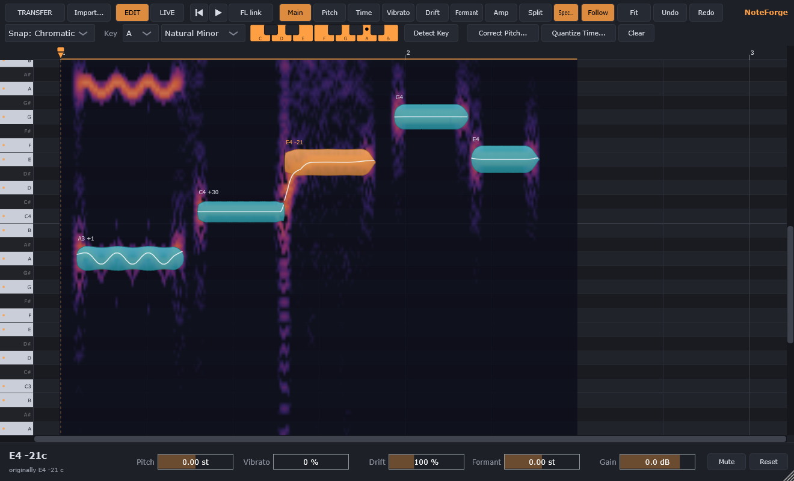
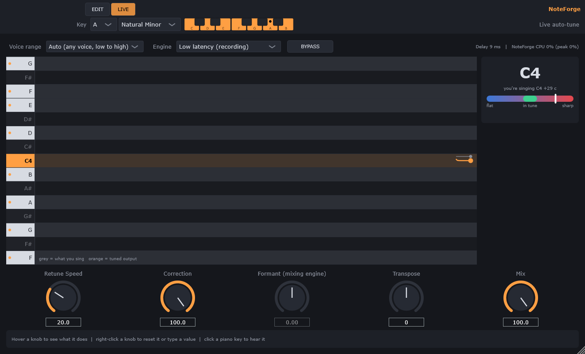

# NoteForge: free auto-tune & pitch correction plugin for FL Studio

**A free auto-tune VST3 plugin for Windows.** It does real-time auto-tune for recording and Melodyne-style vocal pitch editing, in one plugin. No subscription and no sign-up: [download it here](../../releases/latest).



**What you can do with it:**

- **Live auto-tune** while you record, from a natural correction to the hard "T-Pain" effect.
- **Fix individual notes after recording**, like Melodyne: pitch, timing, vibrato and formant.
- **Use it in FL Studio**, or any DAW that loads VST3 plugins on Windows.

NoteForge shows your vocal as notes on a piano roll. Each note is a "blob" with its real pitch curve and the harmonics behind it. You drag the notes to fix pitch and timing, flatten or exaggerate vibrato, and change the character of the voice. It also has a real-time auto-tune mode for recording, with a delay low enough to sing through.

> NoteForge is an independent project. It isn't affiliated with or endorsed by Celemony (Melodyne), Antares (Auto-Tune) or Image-Line (FL Studio).

---

## Features

### Edit mode (Melodyne-style)

- **Drag & drop.** Drop a vocal file (WAV, AIFF, FLAC, OGG or MP3) onto the plugin. When you press play, NoteForge **finds where the file sits in your song by itself**, accurate to the sample. You can also record the audio in with **TRANSFER**.
- **Note detection** finds notes, slides and vibrato, and shows the pitch curve and harmonic spectrum.
- **Tools:**

  | Tool | What it does |
  |---|---|
  | Main | Move notes in pitch (snapped) and time, stretch them |
  | Pitch | Pitch only |
  | Time | Time only |
  | Vibrato | Deepen or flatten vibrato |
  | Drift | Straighten slow drift and scoops |
  | Formant | Change the vocal character |
  | Amp | Change the volume |
  | Split | Split and merge notes |

- **Correct Pitch** is a one-click macro that tunes everything. **Quantize Time** snaps notes to the beat grid. **Detect Key** guesses the song's key.
- **Note picker.** Click piano keys to choose exactly which notes it tunes to, or start from a key/scale preset.
- **Hear any note.** Click a key on the keyboard to hear it on a sampled Steinway grand.
- **Playback marker** on the ruler, like FL's song-position marker. With the optional *FL link*, it moves FL's own playhead and starts FL from there.
- **Workflow:**
  - stereo-safe processing;
  - undo/redo;
  - edits saved inside your FL project;
  - zero added delay in Edit mode.

### Live mode (auto-tune)



- **Two engines:** *Low latency* for recording (about 5–9 ms delay) and *High quality* for mixing (formant control).
- **Auto voice range** tunes everything from deep bass to soprano in the same song.
- **Controls:** Retune Speed (0 ms gives the hard "T-Pain" effect), Correction amount, Formant, Transpose and Mix.
- **BYPASS** lets you compare with and without tuning at exactly the same delay.
- **The display shows:**
  - a piano-roll pitch graph that lights up the key you're singing;
  - a flat/in-tune/sharp meter;
  - hover help on every control.

---

## Download & install

1. Download **`NoteForge-Windows.zip`** from the [**Releases**](../../releases/latest) page and unzip it.
2. Close FL Studio and double-click **`Install NoteForge.bat`**. Click *Yes* when Windows asks for permission.
3. In FL Studio, open **Options → Manage plugins → Find installed plugins**.
4. Put **NoteForge** on your vocal's mixer track, in the first slot (before reverb and delay).

Requirements: Windows 10/11, 64-bit, and a VST3 host (built and tested for FL Studio). Nothing else needs to be installed.

> Windows may show *"Windows protected your PC"* because the files aren't code-signed. Click **More info → Run anyway**. You can read both installer files in Notepad first; together they're about 40 lines.

To install by hand instead, copy the `NoteForge.vst3` folder into `C:\Program Files\Common Files\VST3\`.

---

## Quick start

**Fix a recorded vocal**

1. Drag the vocal file onto NoteForge, or click **TRANSFER** and play the part.
2. Press play once so NoteForge can line the file up with your song.
3. Drag the notes, or click **Correct Pitch…** to tune everything. The edited vocal now plays in place of the original.

**Record with auto-tune**

- Click **LIVE**, then set *Engine: Low latency (recording)* and *Voice range: Auto*. Pick your key, or click notes on the toolbar piano.
- Turn off direct monitoring on your audio interface, so you don't hear your dry voice twice.
- Set an ASIO buffer of 128–256 samples.
- Turn off FL's *Smart disable* for NoteForge.

**Handy controls**

| Action | How |
|---|---|
| See what a control does | Hover over it for about 2 seconds |
| Reset a knob or type a value | Right-click it |
| Zoom time | Mouse wheel over the ruler (like FL) |
| Undo / redo | Ctrl+Z / Ctrl+Y |
| Transpose a note | ↑ / ↓ (Alt = 10 cents) |
| Play / stop from the marker | P |
| Mute a note | Delete |

### Optional: let NoteForge move FL's playhead

Plugins can't control FL's transport directly, so NoteForge sends it over a virtual MIDI cable.

1. Install [loopMIDI](https://www.tobias-erichsen.de/software/loopmidi.html) and create a port named **NoteForge**.
2. The installer already put the *NoteForge Bridge* script in FL's hardware-script folder. In FL, open **Options → MIDI settings → Input**, select the NoteForge port, click **Enable**, and set *Controller type* to **NoteForge Bridge (user)**.
3. The **FL link** button in NoteForge turns green. Dragging the marker tab now moves FL's playhead, and ▶ starts FL from it.

---

## Building from source

**Requirements:**

- Windows with **Visual Studio 2022** or the *Build Tools* ("Desktop development with C++").
- **CMake 3.22+** and **Git**.
- **JUCE 8.0.9** is downloaded automatically.

```powershell
cmake -S . -B build -G "Visual Studio 17 2022" -A x64
cmake --build build --config Release
```

The plugin is built to `build/NoteForge_artefacts/Release/VST3/NoteForge.vst3`. To build the shareable zip, run `scripts/make-package.ps1`.

- **Using your own JUCE copy:** pass `-DJUCE_DIR=path/to/JUCE`.
- **Installing on every build:** pass `-DNOTEFORGE_COPY_PLUGIN=ON` and build from an administrator prompt; the build then copies the VST3 into the system folder.

### Tests

`NoteForgeTests` is a console program with over 200 checks. It synthesises realistic voices (jitter, breath and vowel changes) and covers:

- pitch detection, plus pitch, vibrato, formant and timing edits, measured afterwards to within about a cent;
- loudness, clicks and glitches;
- both live engines (delay, accuracy, breath handling, bypass);
- stereo, sample-rate changes and save/load;
- drag-and-drop line-up and the FL link messages;
- that the audio callback never allocates memory;
- loading the built `.vst3` through a real VST3 host.

```powershell
build\NoteForgeTests_artefacts\Release\NoteForgeTests.exe
# to also host-load the plugin:
$env:NF_VST3_PATH = "$PWD\build\NoteForge_artefacts\Release\VST3\NoteForge.vst3"
```

To analyse a real recording, set `NF_REAL_WAV=path\to\vocal.wav`. The test program then reports the detected notes, renders typical edits and writes screenshots to `test-out\real\`.

---

## How it works

No AI and no internet: everything is classic signal processing running locally.

| Part | Technique |
|---|---|
| Pitch tracking | YIN with an FFT difference function, a two-period periodicity check (so breath noise isn't taken for notes), and octave and edge clean-up |
| Note detection | Vibrato-aware segmentation of the pitch curve, plus loudness dips |
| Edit-mode resynthesis | TD-PSOLA with pitch marks on the glottal pulses. Formants are shifted by resampling each grain, timing by a time map, and loudness is matched afterwards. Only the edited region is re-rendered, and the result is sample-identical to a full render |
| Live, high quality | Streaming PSOLA with causal pitch frames |
| Live, low latency | Pitch-synchronous variable delay line, which jumps one period with a cross-fade |
| Spectrum view | Frequency-reassigned STFT, so harmonics sit exactly on their notes |
| Drag-and-drop line-up | Coarse FFT cross-correlation, refined to the exact sample |

Project layout:

| Folder | Contents |
|---|---|
| `Source/dsp` | Pitch detection, analysis, renderer, live tuner, spectrogram, alignment, piano sampler |
| `Source/model` | Notes, scales, editing operations |
| `Source/ui` | Editor, piano roll, live page, note picker, FL link |
| `Source/Engine.*` | Transfer and import, background analysis and rendering, project save/load |
| `Tests` | The test program and a test for the FL bridge script |
| `Tools` | Piano sample preparation and the FL bridge script |
| `installer` | Installer and quick-start text for the release zip |

---

## Limitations

- **One voice at a time.** NoteForge works on lead vocals and single instruments, not chords. Melodyne's polyphonic "DNA" mode isn't implemented.
- **No ARA.** FL Studio doesn't support ARA, so audio has to be dropped in or transferred by playing it.
- **Windows only** for now. A macOS build would need compiling on a Mac.

## Credits

- Built with [JUCE](https://juce.com).
- Piano sounds are Steinway & Sons Model B recordings from the [University of Iowa Electronic Music Studios](https://theremin.music.uiowa.edu/MIS.html), which are free for any use. They're retuned to exact pitch by `Tools/SamplePrep.cpp`.

## License

NoteForge is free software under the **GNU Affero General Public License v3.0**. See [LICENSE](LICENSE). It uses JUCE under JUCE's AGPLv3 option.
